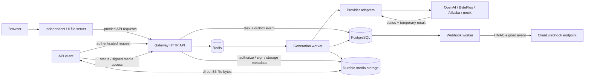
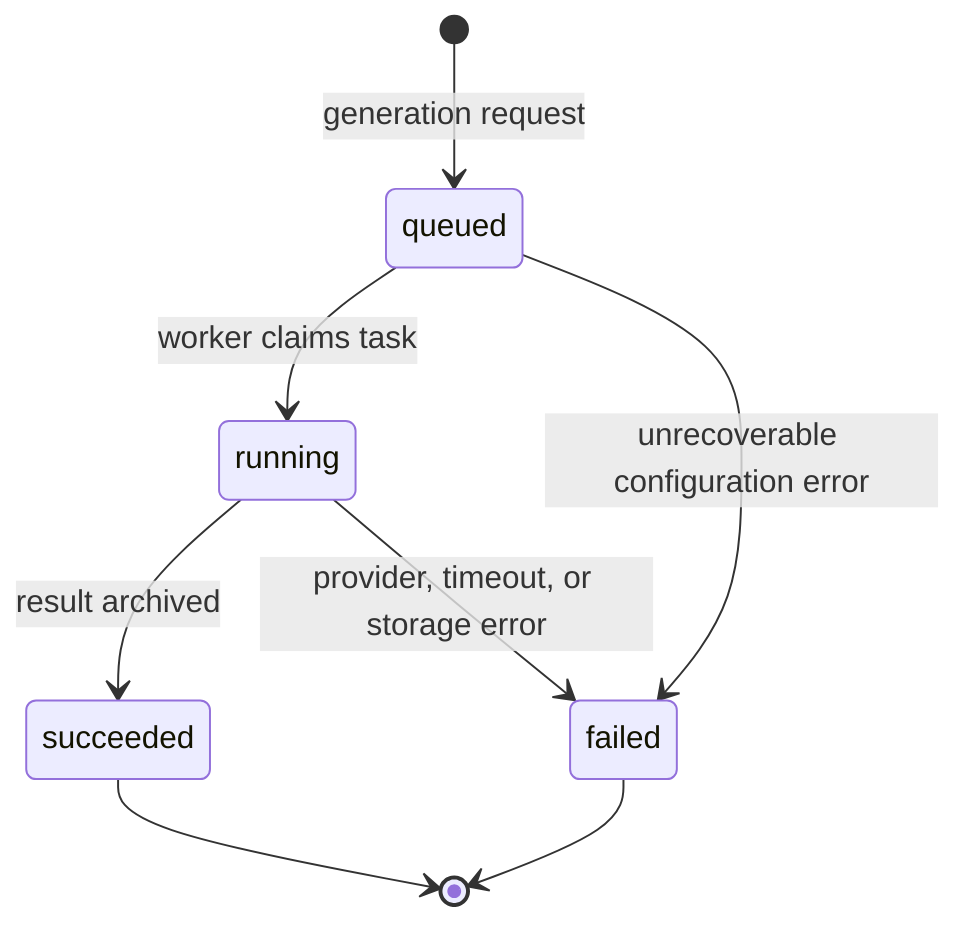

# Architecture

Media Gateway separates the public media-generation contract from vendor APIs.
The same task lifecycle is used for images, video, speech, and music.

## Components

`cmd/gateway` serves the JSON API, authentication endpoints and public API resources.
The independent `web/` artifact serves the administrative UI through Caddy; see
[Frontend separation](frontend-separation.md). The gateway validates
provider-neutral inputs, writes durable task state, and queues work. It never
submits paid inference requests itself.

`cmd/worker` resolves the adapter recorded on each task, submits or polls the
vendor operation, records usage, archives the result, and commits the terminal
state. A recovered running task with no provider task ID is failed rather than
blindly resubmitted, avoiding an ambiguous duplicate paid generation.

PostgreSQL is the source of truth for Google and verified email accounts, opaque sessions, owned tasks,
provider settings, encrypted credentials, and webhook deliveries. Redis is coordination infrastructure, not
the durable business record. The Gateway can reconstruct missing queue entries
from PostgreSQL.

Provider adapters live in `plugins/provider/*` and implement the core
`MediaProvider` and `ModelCatalog` interfaces. The public API follows OpenAI naming
where possible while retaining asynchronous execution and provider-specific options;
see [the API contract](openai-api.md).

Local and S3-compatible storage implement result persistence. Provider result URLs
are temporary: the worker archives their contents before marking the task successful.
For S3, clients upload and download bytes directly using short-lived signed storage
URLs. Gateway endpoints authorize access and exchange metadata or redirect to storage;
they do not relay S3 file bytes. Local storage retains filesystem serving. See
[direct file transfers](direct-storage.md) for the upload protocol and CORS setup.

## Task lifecycle

The diagram uses internal task states. Canonical OpenAI-style endpoints expose
`queued`, `in_progress`, `completed` and `failed`; internal worker states retain
`queued`, `running`, `succeeded` and `failed`.

Task creation supports an `Idempotency-Key`. Reusing the key with the same
normalized request returns the original task; using it for different content is
a conflict.

## Trust boundaries

- Generation, catalog, task and reference endpoints require a personal Gateway API key
  or the separate deployment service key. Browser sessions authorize account, provider,
  storage and key administration. Authentication resolves a verified Google identity
  or email account to a stable owner. Organization keys additionally require active
  membership. System privileges require the current system role and, for bearer
  keys, the `system:manage` scope; the role alone does not widen a restricted key.
- Provider inference and billing credentials are encrypted before PostgreSQL
  storage and scoped to their owner. The encryption key must be stable,
  independent, and kept outside the database.
- Generated media may contain sensitive content. Files and database backups
  need the same access controls as the API.
- Outbound webhook URLs reject non-public addresses at admission and delivery. The
  sender validates DNS answers, dials the validated address, and does not follow
  redirects or use environment proxies. Network egress controls provide an additional
  deployment boundary; see [webhooks](webhooks.md).
- The bundled Compose stack is local-only. TLS and Internet-facing controls are
  the responsibility of the deployment layer.

## Extension points

- provider adapters: `core.MediaProvider` and `core.ModelCatalog`;
- result storage: `storage.Store`;
- task and webhook persistence: repository interfaces in `internal/core`;
- queue backend: `core.TaskQueue`.

See [provider-development.md](provider-development.md) before adding an adapter.

## Personal API keys

The console and integrations share the same API and account ownership. Google
and verified email sessions bootstrap key issuance; personal bearer keys resolve to the same user.
`generation` is the default scope; `providers:manage`, `storage:manage` and `keys:manage` are explicit
opt-ins. A key cannot grant scopes it lacks. The legacy `CLIENT_API_KEY` remains a
separate system owner and cannot issue personal keys.

Secrets have 256 bits of cryptographic randomness. Only their SHA-256 hashes and
short display prefixes are stored. The full secret is returned once at creation.
Revocation and expiration are checked in PostgreSQL on every authenticated request.
Revoking a key does not cancel accepted tasks or invalidate already signed media
URLs. `tasks.api_key_id` preserves the originating credential across retries and
revocation; ownership and idempotency remain account-scoped.

The public `/docs` console view renders `/openapi.json`, generated at runtime from
the embedded `docs/openapi.yaml`. `/openapi.yaml` serves the same source for tools.
Session-backed browser mutations use Go’s cross-origin request protection. Explicit
credential headers take precedence over sessions, including invalid credentials.

Storage settings are account-scoped and read from PostgreSQL when archiving starts.
A generation pins one local/S3 destination for its result and optional last frame.
S3 storage keys include a connection ID, so reads use the original encrypted
connection even after a settings change. Legacy filesystem keys still use local
storage. Signed media requests resolve storage in the verified task owner's
context. Only worker archival of provider results uses temporary staging. Browser
reference uploads go directly to S3; S3 reads use signed URLs or redirects.

## Parallel execution and recovery

Provider operations run concurrently with Redis delivery leases and PostgreSQL
fencing tokens. Pending polls are scheduled durably and release their active claim.
See [concurrent workers](concurrent-workers.md) for scheduling, resource controls,
recovery behavior, migrations and verification.
